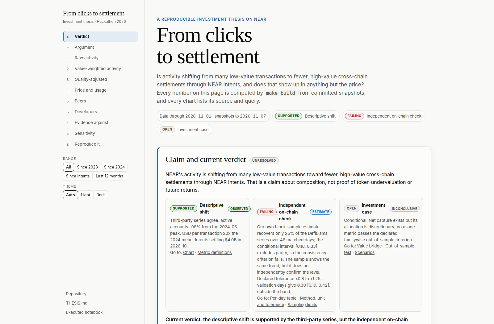

# From clicks to settlement

**A reproducible investment thesis on NEAR · NEAR Hackathon 2026 · Investment Thesis track**

Do falling account counts hide a shift toward cross-chain settlement? This project compares activity, behavioral proxies, Intents flows and token value capture using committed public snapshots.

**Current verdict: unresolved.** Third-party series support a descriptive shift, but the declared sampled on-chain cross-check fails. Complete-day validation provides additional qualified evidence; the investment case remains conditional. Settlement growth alone does not establish undervaluation.

[Read the thesis](THESIS.md) · [Methods and implementation](docs/IMPLEMENTATION.md) · [Reproducibility](docs/REPRODUCIBILITY.md)



## Review the product

- **Canonical submission repository:** [Alberto-Campos-de-la-Torre/near-settlement-thesis](https://github.com/Alberto-Campos-de-la-Torre/near-settlement-thesis). This is the same project continued from the upstream research, not a second submission.
- **Hosted dashboard:** [Open the live dashboard](https://alberto-campos-de-la-torre.github.io/near-settlement-thesis/). GitHub Pages deploys only after the build and validation jobs succeed; the local build below remains reproducible.
- **Public X demo post/video:** pending publication by the team. No demo-post URL has been supplied or verified. Video and production files are intentionally kept outside this repository.
- **Origin and development history:** [provenance and dated upstream baseline](docs/PROVENANCE.md). The November 10 snapshot commit is not the original research start date.

## Reproduce: do X, see Y

Requires Git, GNU Make, [uv](https://docs.astral.sh/uv/) and Python 3.12. No wallet, Google account or API keys are needed. Initial dependency installation requires internet; Jupyter requires localhost ports.

```bash
git clone https://github.com/Alberto-Campos-de-la-Torre/near-settlement-thesis.git
cd near-settlement-thesis
uv sync --locked --all-extras --python 3.12
make build
make test
make check-generated
make serve
```

1. `make build` rebuilds tables, models, charts, `THESIS.md`, the dashboard and the executed notebook from committed inputs, without external HTTP requests.
2. `make test` runs the regression suite. `make check-generated` checks exact text/source hashes and numerical agreement (`rtol=1e-9`, `atol=1e-11`) against committed artifacts.
3. Open **http://localhost:8080/**. Change the date range, open a chart table, then open **Source and query** to inspect its evidence. Theme controls work in both the dashboard and reading pages.
4. Open **THESIS.md** or **Executed notebook** from the dashboard, inspect the calculations and use **Back to dashboard** to return. Method pages are bundled locally and also work from `file://`.

Optional browser checks: `uv run --with playwright python -m playwright install chromium`, then `uv run --with playwright python tests/browser_dashboard.py`. These check rendering, controls, keyboard navigation, mobile layout, evidence labels, injection resistance and chart geometry.

## What NEAR contributes

FastNear supplies NEAR blocks and successful receipt logs; `intents.near` events expose settlement activity. NearBlocks provides account and receipt evidence; DefiLlama/Dune provides the reference settlement and revenue series. Public NEAR BigQuery extracts provide complete-day and full-month comparisons.

The **Intents Explorer API is not implemented**: no partner JWT was available. DefiLlama/Dune is explicitly a substitute reference, not an Explorer response. QAA describes behavior, not verified human identities. Buyback-labelled receipts are not proof of burns, dividends or exact funding attribution. See the [thesis limitations](THESIS.md#gaps-provenance-and-reproduction).

## Development disclosure and license

**Claude Code** assisted parts of the upstream implementation; **Codex** assisted subsequent review, fixes, tests and reviewer presentation. [AI-assisted development disclosure](docs/AI_DISCLOSURE.md) lists the affected components and attribution limits. Git authorship remains human. Dependencies are locked in `pyproject.toml` and `uv.lock`.

Original MIT attribution is retained in [LICENSE](LICENSE). The upstream is historical research provenance; **this repository is the canonical delivery location**. We cannot change an upstream README from this repository. This is one project and one submission.

## Publication and validation

CI checks the publication policy, rebuilds the evidence, runs tests and verifies generated outputs. Only successful pushes to `main` can deploy the static dashboard; deployment permissions are isolated from the read-only build. [Security policy](docs/SECURITY.md).

Run `python tools/check_publication.py` before publication. Credentials, private cloud identifiers, video/audio, subtitles, narration and recording/export scripts stay outside Git. The dashboard screenshot is a product capture, not a video production asset. [Implementation and optional integrations](docs/IMPLEMENTATION.md) documents separate network acquisition and optional signing commands.
